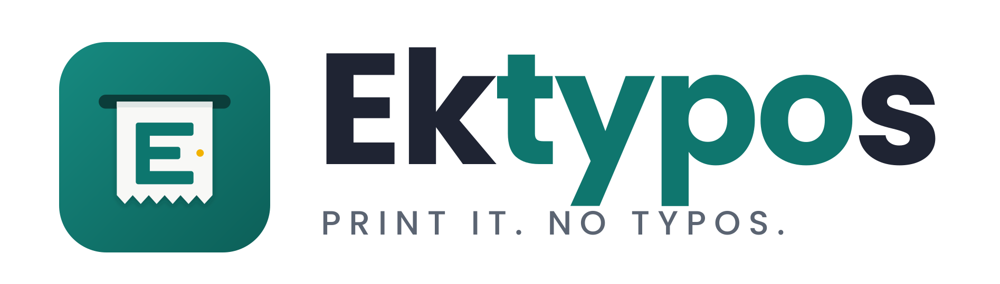

# Ektypos

**Print it. No typos.** A label designer and Bluetooth printing tool that runs entirely in your browser, offline, in a single HTML file. No app, no account, nothing is sent anywhere except to your printer.

Supported and tested on real hardware: the Fichero **D11s** label printer and the Fichero **A4** printers **6181**, **4437** and **5622**. The protocol notes in [docs/PROTOCOL.md](docs/PROTOCOL.md) also cover the other Fichero models (4575, 3561, 5655). The goal is a growing list of Bluetooth thermal printers.

## How to use it
- **Online:** open `https://Diastasis.github.io/ektypos/` in **Chrome based browsers** (desktop or Android). Web Bluetooth is not available in Safari or Firefox.
- **Install:** in Chrome, menu, **Install app**. It then works offline.
- **Offline copy:** download `index.html` from this repository and open it in Chromium based browser.

## Features
A single offline HTML application with a label and document designer, text, images, barcodes and QR codes, templates, DataMatrix and PDF417 codes, CSV and Excel batch printing with field filters, serial number generaton, and multi-sheet layouts. It runs on desktop and mobile and in the future it will be able to be installed as a PWA or Android app.

## Repository layout
| Path | Content |
|---|---|
| `index.html` | The whole program |
| `manifest.webmanifest`, `sw.js` | Make it installable and available offline (hosting only) |
| `assets/icons/` | App icons used by the manifest |
| `assets/brand/` | Logos and icon sources (SVG and PNG) |
| `docs/PROTOCOL.md` | Bluetooth protocol notes for all Fichero printers |
| `LICENSE`, `THIRD-PARTY-NOTICES.md` | Licenses |

## License

Ektypos is free software: you can redistribute it and/or modify it under the
terms of the GNU Affero General Public License as published by the Free
Software Foundation, either version 3 of the License, or (at your option) any
later version. See [LICENSE](LICENSE).

Copyright (C) 2026 The Ektypos authors.

If you run a modified copy of Ektypos on a server for others to use, the AGPL
requires you to offer those users the source code of your version. The
"Source code" link in the About dialog does this; keep it pointing at your
modified source.

Ektypos bundles third-party fonts, icons and code under their own licenses
(MIT, Apache 2.0, CC BY 4.0, SIL OFL 1.1, GUST Font License). See
[THIRD-PARTY-NOTICES.md](THIRD-PARTY-NOTICES.md). Labels and documents you
create with Ektypos are yours; the AGPL does not apply to them.

### Trademarks and affiliation

Ektypos is an independent project. It is not affiliated with, endorsed by or
sponsored by the maker or sellers of Fichero printers. "Fichero" is used only
to describe which printers Ektypos works with.
